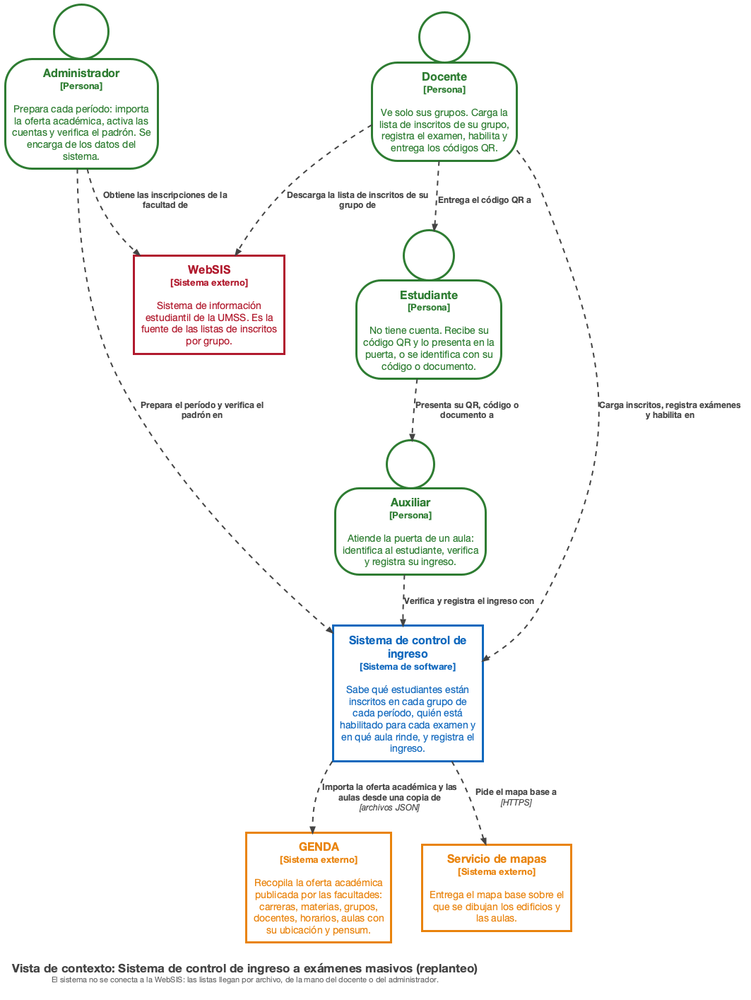
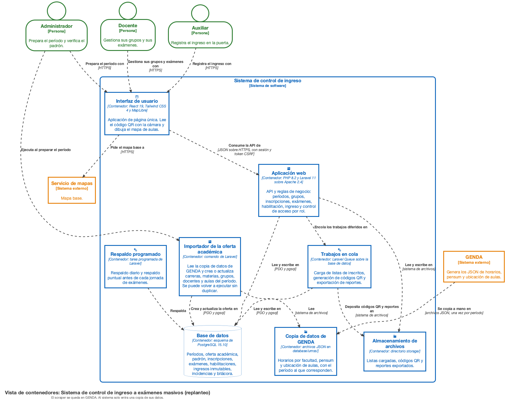
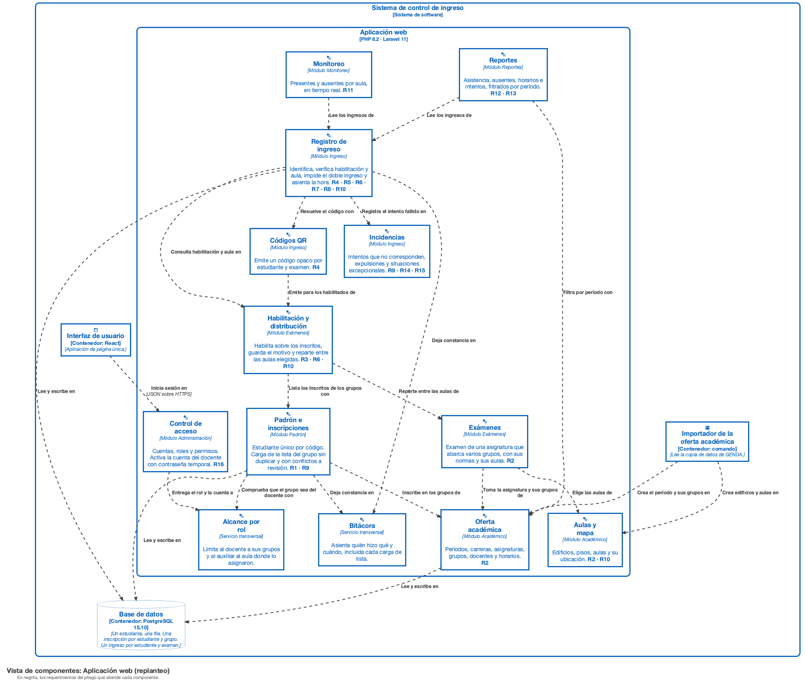
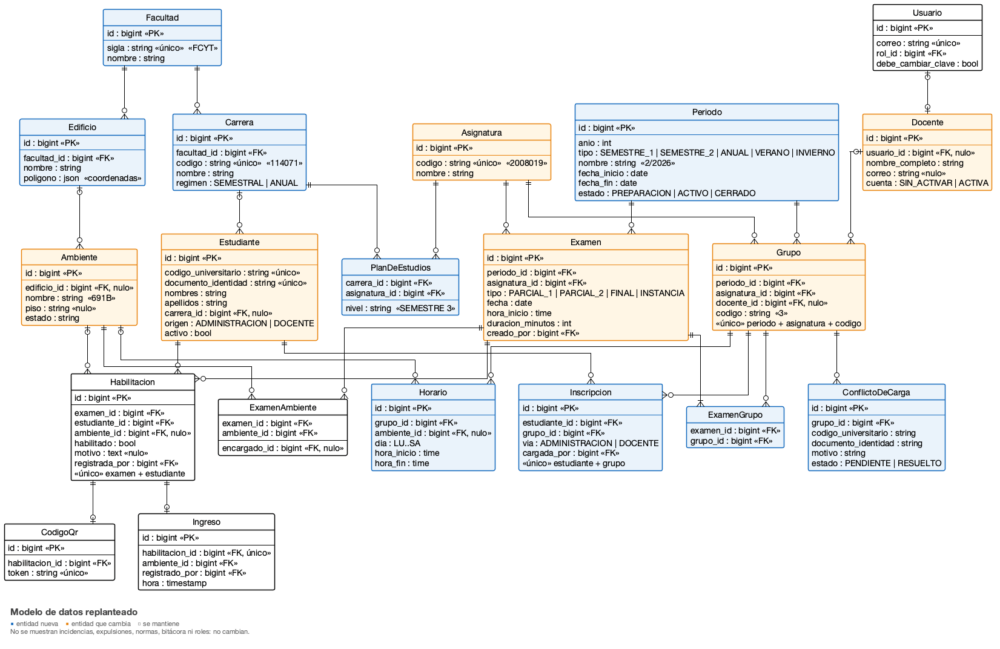
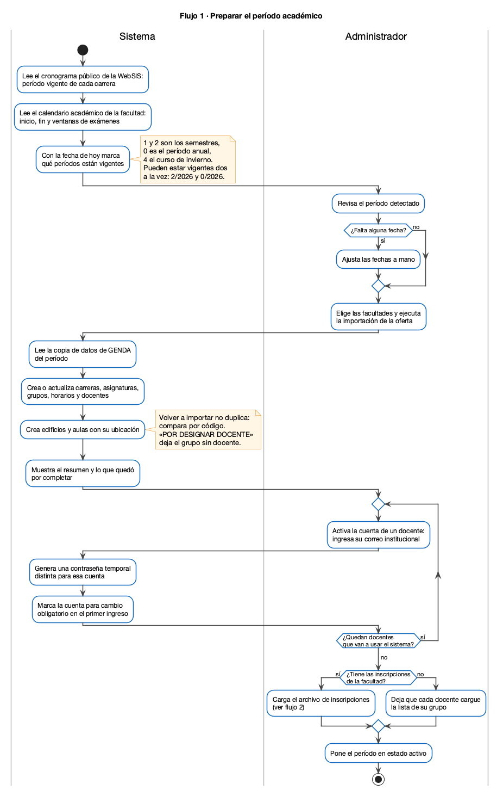
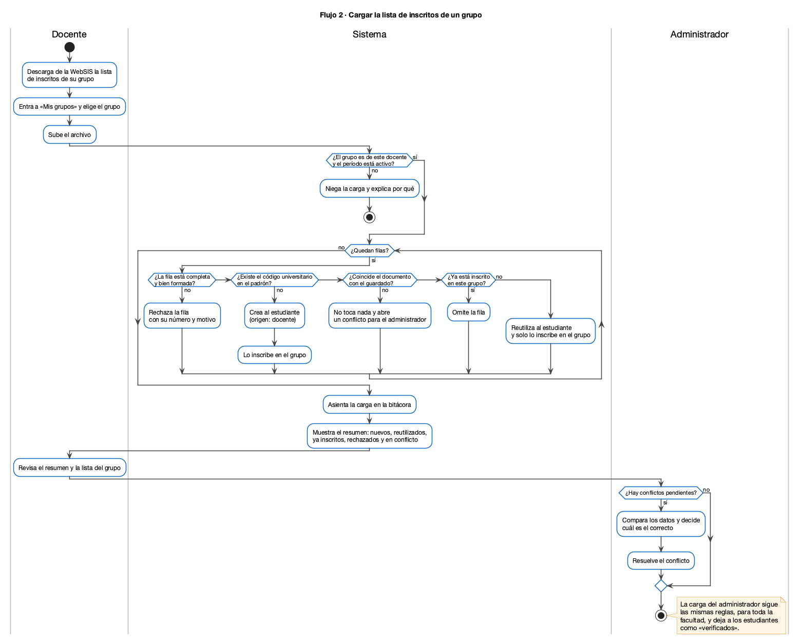
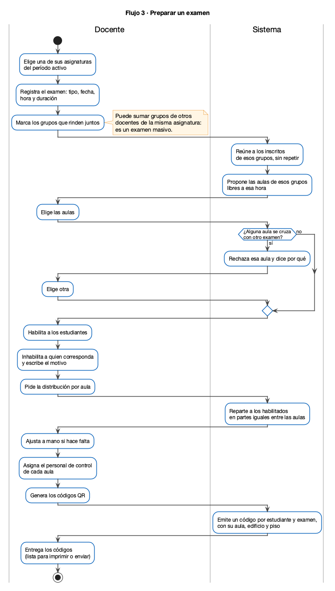
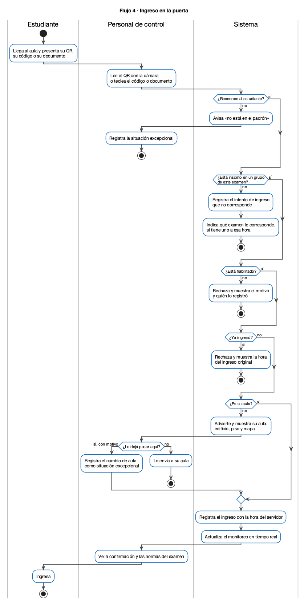

# Replanteo del sistema

Propuesta de rediseño que sale de la octava revisión con la consultora (29 de septiembre
de 2026). Es un borrador de trabajo: todavía no se implementó nada de esto en el código
del proyecto guía. Lo que hay es el diseño (este documento y sus diagramas) y una maqueta
navegable en la carpeta `Maquetacion/` del espacio de trabajo, junto a este repositorio
(`../Maquetacion` desde la raíz del proyecto guía).

El contexto completo que respalda estas decisiones (qué pide el pliego, cómo se toman los
exámenes en la universidad, las fuentes de datos, lo descartado y las preguntas abiertas)
está en [`analisis/analisis_contexto.pdf`](analisis/analisis_contexto.pdf).

## Por qué se replantea

La consultora preguntó, puesta en el lugar de una docente: «¿cómo sé quiénes son mis
estudiantes de IHC?». El diseño original no lo podía responder:

- El padrón era una sola lista de toda la universidad, sin relación con ninguna materia.
- La habilitación de cualquier examen mostraba a todos los estudiantes del padrón.
- El docente no estaba limitado a sus grupos.
- Asignaturas, docentes y ambientes se cargaban a mano.

El pliego, además, exige saber quién está inscrito en cada materia: el requerimiento 9
pide registrar el intento de ingreso de un estudiante «no registrado en la materia».

## Decisiones

| # | Decisión | Motivo |
|---|---|---|
| 1 | La oferta académica se importa de una copia de los datos de GENDA | Carreras, materias, grupos, docentes, horarios y aulas ya están publicados por las facultades. Cargarlos a mano es trabajo doble y fuente de errores |
| 2 | El scraper se queda en GENDA; al sistema entra solo la copia de datos | El sistema no depende de sitios externos para funcionar, y no hereda el código de terceros que usa GENDA |
| 3 | El período académico es una entidad, y no se crea a mano: se detecta de lo que publica la universidad y de la fecha del sistema | Conviven carreras semestrales y anuales, y el sistema tiene que servir más de una gestión sin mezclar datos. Ver «De dónde sale el período» |
| 4 | El grupo pertenece a un período; la asignatura, el docente, el aula y el estudiante no | Lo que cambia cada gestión es quién dicta qué y quién se inscribe, no las personas ni las materias |
| 5 | El estudiante existe una sola vez; la inscripción lo une a un grupo | Evita la redundancia cuando varios docentes cargan al mismo estudiante |
| 6 | Las listas de inscritos las carga el docente de su grupo o la administración, nunca el estudiante | La autoinscripción con un código de curso deja pasar intrusos, como señaló la consultora |
| 7 | El docente no edita los datos de un estudiante que ya existe; las diferencias quedan como conflicto para la administración | Una carga no puede corromper la de otro docente |
| 8 | El examen es de la asignatura y abarca varios grupos | Es lo que hace masivo a un examen: un parcial junta varios grupos en varias aulas |
| 9 | El docente ve solo sus grupos; puede sumar a su examen grupos de otros docentes de la misma asignatura | Responde a «mis estudiantes» sin impedir el examen conjunto |
| 10 | Las cuentas de docente se activan con el correo institucional y una contraseña temporal individual, de cambio obligatorio | La oferta publicada trae el nombre del docente, no su correo. Una contraseña común para todos dejaría entrar a cualquiera antes del cambio |
| 11 | El estudiante no tiene cuenta y no marca su propia presencia | El pliego pone la verificación en la puerta, a cargo del personal (requerimientos 4, 6 y 7) |
| 12 | El aula se usa como dato, sin capacidad: el docente elige cualquiera de las aulas importadas | La capacidad no está publicada en ninguna fuente y por ahora no es información necesaria |
| 15 | Aulas y docentes se ven del campus completo o filtrados por facultad, y cada facultad conserva su color | El administrador trabaja con toda la universidad; el color permite distinguir de un vistazo a quién pertenece cada edificio |
| 16 | El docente es una sola persona con una sola cuenta, aunque dicte en más de una facultad | En la oferta 2/2026 hay 29 docentes en esa situación, de 849. Sus grupos se muestran agrupados por facultad |
| 17 | El docente ve todos sus exámenes del período en una sola lista, de todas sus asignaturas, y las pantallas que dependen de un examen llevan un selector | Un docente con dos asignaturas tiene al menos cuatro exámenes por semestre; sin la lista no sabe en cuál está trabajando ni qué le falta a cada uno |
| 18 | El control del ingreso lo hacen el docente y sus auxiliares, asignados por examen y por aula (a cargo o de apoyo); no hay un rol global de personal de control. **Propuesto** | En la universidad el examen lo toma el docente, solo o con auxiliares, y a veces un auxiliar queda a cargo |
| 19 | El auxiliar entra con cuenta propia; para el ayudante ocasional hay un código de acceso por aula. **Propuesto** | La cuenta deja registrado quién hizo cada ingreso; el código cubre el caso de último momento |
| 20 | Un aula puede tener varios exámenes a la misma hora: el sistema avisa, no lo impide. **Propuesto** | El auditorio se comparte entre grupos y entre materias |
| 21 | La puerta trabaja por aula y hora: al identificar al estudiante, el sistema resuelve a qué examen de esa aula pertenece. **Propuesto** | Quien atiende no tiene que saber de qué materia es cada estudiante |
| 22 | El docente tiene una vista de su examen en curso, con todas sus aulas. **Propuesto** | Es lo que necesita cuando pasa de un aula a otra |
| 23 | Se quita el rol de responsable académico. Los roles son tres: administrador, docente y auxiliar | No figura en el pliego y sus funciones quedaron cubiertas: el docente sigue su propio examen y el auxiliar, su aula |
| 24 | El seguimiento en vivo es del docente y del auxiliar, no del administrador | El administrador se encarga de los datos del sistema; controlar y seguir el examen es de quien lo toma |
| 25 | El auxiliar y el docente reportan incidencias durante el examen; el docente las ve y las atiende | **Propuesto.** Quien está en el aula deja asentado lo que pasa (intento de ingreso no autorizado, suplantación, material no permitido, expulsión, cambio de aula). Las expulsiones y las situaciones excepcionales de la puerta quedan también como incidencia. El docente del examen las ve en «En curso», por aula, y las marca como atendidas |
| 26 | El acceso es con usuario y contraseña; el correo es un dato de contacto que se puede agregar después | No hay una regla única para deducir el correo del docente (conviven al menos dos formatos y dominios; ver `database/umss/fuentes.json`). El sistema propone el usuario a partir del nombre y el administrador lo puede corregir. El correo del estudiante sí se deduce exacto: código SIS + `@est.umss.edu` |
| 14 | Solo entran las facultades cuya oferta se puede obtener de forma automática: FCyT, FCE, FHCE y FACH | Derecho no tiene fuente web y los datos de Odontología son de un período anterior. Quedan fuera |
| 13 | El alcance son los exámenes de las materias (parciales, finales, segunda instancia), no el examen de ingreso a la universidad | El pliego habla de asignatura, código universitario e inscritos en la materia |

## Diagramas

Fuente en PlantUML en [`diagramas/`](diagramas/); se compilan con `./compilar.sh` desde
esa carpeta.

### Arquitectura (modelo C4)

| Nivel | Diagrama | Qué cambia |
|---|---|---|
| 1 · Contexto |  | Aparecen GENDA, la WebSIS y el servicio de mapas como sistemas externos |
| 2 · Contenedores |  | Se agregan el importador y la copia de datos de GENDA |
| 3 · Componentes |  | Oferta académica, aulas y mapa, padrón e inscripciones, y el alcance por rol |

### Modelo de datos

En azul, las entidades nuevas; en naranja, las que cambian.

### Flujos

| Flujo | Quién | Diagrama |
|---|---|---|
| 1 · Preparar el período | Administrador |  |
| 2 · Cargar la lista de inscritos | Docente y administrador |  |
| 3 · Preparar un examen | Docente |  |
| 4 · Ingreso en la puerta | Personal de control |  |

## De dónde sale el período

Consultado el 4 de octubre de 2026. Los enlaces quedaron registrados en
[`database/umss/fuentes.json`](../../database/umss/fuentes.json), con cómo leer cada uno y
sus cuidados: es de donde tienen que tomarlos los scrapers y el importador. Hay tres
fuentes públicas para el período, y se usan en este orden:

| Fuente | Qué da | Formato |
|---|---|---|
| [Cronograma de inscripciones de la WebSIS](https://websis.umss.edu.bo/cron_inscripcion.asp?ID=127&SERVICIO=u&codser=UMSS&idCat=36) | El período vigente de cada una de las 92 carreras de la universidad, con su código, y la fecha en que abre su inscripción | HTML, una sola página para las 18 facultades |
| El horario de cada facultad, que GENDA ya procesa | El período al que corresponde la oferta («Gestión 2/2026») | Ya está en los JSON, campo `INFO.SEMESTER` |
| [Calendario académico de la FCyT, gestión II/2026](https://www.fcyt.umss.edu.bo/wp-content/uploads/2026/06/CALENDARIO-ACADEMICO-GESTION-II-2026.pdf) | Inicio y fin del semestre y las ventanas de exámenes, día por día | PDF con texto, una fila por día |

Lo que se sabe de la numeración, por esas fuentes: **1** y **2** son los semestres, **0**
es el período anual (Arquitectura y otras carreras anuales) y **4** es el curso de
invierno de la FCyT. Hoy están vigentes a la vez `2/2026` y `0/2026`.

Fechas de la FCyT para 2/2026, del calendario: inicio el 10 de agosto, primeros parciales
del 12 al 31 de octubre, segundos parciales del 7 al 17 de diciembre, finales y segunda
instancia del 19 al 24 de diciembre, y cierre el 26 de diciembre.

Cómo se decide el período vigente: el sistema compara la fecha de hoy con el inicio y el
fin de cada período conocido. Si una facultad no publica su calendario en un formato que
se pueda leer, sus fechas se ajustan a mano; es lo único manual.

Límites de lo encontrado:

- La «fecha de inicio» de la WebSIS es la apertura de la inscripción, no el primer día de
  clases.
- Esa página trae carreras con períodos viejos (por ejemplo `0/2011`): son planes cerrados
  y hay que descartarlos.
- La Facultad de Ciencias Económicas publica su
  [calendario II-2026](https://www.fce.umss.edu.bo/webpage/node/2568) como PDF e imagen; no
  se comprobó si el PDF tiene texto. De las demás facultades no se encontró el calendario.
- El código del curso de verano no se confirmó.

## Qué aporta GENDA y qué no

| Dato | Estado | Cómo se cubre lo que falta |
|---|---|---|
| Horarios 2/2026 de FCyT, FCE, FHCE y FACH | Disponible | — |
| Horarios de FCJP y FODO | Solo de 1/2025, y Derecho sin fuente web | Quedan fuera del sistema |
| Pensum de 105 carreras | Disponible | — |
| 302 aulas ubicadas en 59 edificios | Disponible | — |
| Capacidad de las aulas | No existe | No se usa |
| Correo de los docentes | No existe | Lo ingresa la administración al activar la cuenta |
| Estudiantes e inscripciones | No existe | Lista de la WebSIS, cargada por el docente o la administración |
| Auxiliares de docencia | Se pierde al procesar | Está en el texto crudo; se ajusta el parser si hace falta |

## Historias que cambian

| Historia | Cambio |
|---|---|
| HU-01 Autenticación | Dominio del correo ya puesto; cambio obligatorio de la contraseña temporal |
| HU-02 Roles y permisos | Tres roles en vez de cuatro; alcance por rol: docente a sus grupos, auxiliar al aula donde lo asignaron |
| HU-03 Registro de estudiantes | El estudiante guarda su origen; solo la administración corrige datos |
| HU-04 Carga masiva | Pasa a ser la carga de la lista de un grupo, sin duplicar y con conflictos |
| HU-05 Asignaturas | Dejan de cargarse a mano: vienen de la importación |
| HU-06 Ambientes | Vienen de la importación, con edificio, piso y ubicación; ya no llevan capacidad |
| HU-08 Registro de exámenes | El examen es de la asignatura y abarca varios grupos |
| HU-10 Ambientes del examen | El docente elige las aulas; se sugieren las de los horarios de los grupos. Se quita la comparación de capacidad contra habilitados |
| HU-14 Asignación de estudiantes a ambiente | El reparto es en partes iguales entre las aulas elegidas; se quita el tope por capacidad |
| HU-11 Habilitación | La lista son los inscritos de los grupos del examen |
| HU-17 Códigos QR | La credencial incluye el aula, el edificio y el piso |
| HU-20 Verificación del ambiente | Muestra en el mapa el aula que le corresponde |
| HU-27 y HU-28 Monitoreo | El docente sigue su examen, aula por aula, y el auxiliar el aula que atiende. No hay vista de toda la universidad |
| HU-29 a HU-34 Reportes | Filtro por período; los consolidados pasan al administrador |

Historias nuevas: **importar la oferta académica**, **detectar y ajustar los períodos**, **activar
las cuentas de docente** y **resolver conflictos de carga**.

Transversal a todas las pantallas, por la misma revisión: asterisco en los campos
obligatorios, validación mientras se escribe y el usuario y su rol a la vista.

## Pendiente de decidir

- El formato exacto de la lista de inscritos que descarga el docente de la WebSIS: hay que
  conseguir un archivo de ejemplo.
- Qué servicio de mapas se usa como base. En la maqueta se dibujan solo los edificios.
- Si el aviso al docente de otro grupo, cuando lo suman a un examen, necesita su
  aprobación o alcanza con notificarlo.
